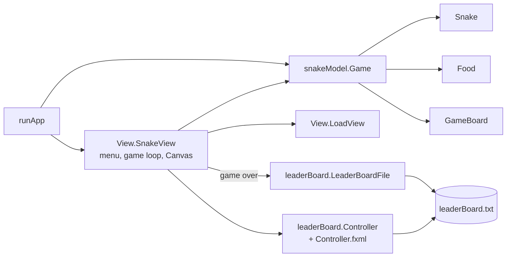

# Snake Cake

A JavaFX take on Snake: steer the snake to eat cake, avoid the walls and your own tail, and get your score onto a saved leaderboard.


## Demo

<!-- TODO: demo link or video -->

## Overview

Snake Cake is a desktop Snake game built as a team project for CSC207 (Software Design). You enter a name on the main menu, play on a tiled board, and when the game ends your score is written to a local leaderboard you can open from the menu. The project splits game logic from the JavaFX views so the rules can change without touching the rendering code.

## Key features

- Arrow keys or WASD to steer, and the snake can't reverse into itself.
- `P` pauses and resumes the game.
- `C` toggles a colour-blind mode that swaps the green board and blue snake for a grey board and a black snake.
- A main menu with a name field, Start, Load and Leaderboard buttons.
- A leaderboard table (JavaFX FXML) sorted by score, kept between runs in `leaderBoard.txt`, with a colour picker for the background.
- Cake spawns on a random free tile, never on the snake's body.

## Tech stack

| Area | Tools |
|---|---|
| Language | Java |
| UI | JavaFX (Canvas, Timeline, FXML, TableView) |
| Persistence | Java object serialization |
| IDE | IntelliJ IDEA module (`snakeGame/snakeGame.iml`) |

## Architecture

The code is split into three packages under `snakeGame/src`:

- `snakeModel`: the rules. `Game` holds the `Snake`, `Food` and `GameBoard`, checks for wall and self collisions, and handles eating.
- `View`: JavaFX screens. `SnakeView` builds the menu, runs the game loop on a 100 ms `Timeline` and draws the board on a `Canvas`. `LoadView` lists saved `.ser` games.
- `leaderBoard`: `Player` (serializable, compared by score), `LeaderBoardFile` (reads, sorts and writes the leaderboard), and `Controller` with `Controller.fxml` for the table screen.

`runApp` is the entry point. It creates a `Game` and hands it to `SnakeView`.



## Technical highlights

- Each tick of the `Timeline` draws the frame, moves the snake, then asks `Game.gameState()` whether the head has left the board or hit the body. Rendering only reads from the model, so the collision and growth rules live in one place.
- `Food` picks a random tile and retries until it lands on one the snake doesn't occupy.
- The leaderboard stores `Player` objects with Java serialization. `Player` implements `Comparable`, so the list is sorted by score before it is written back.
- The board and snake colours are model state (`GameBoard.setTileColor1/2`, `Snake.setSnakeRace`), so colour-blind mode is a palette swap and the drawing code doesn't change.

## Getting started

Requires a JDK and the JavaFX SDK (the FXML targets JavaFX 19). <!-- verify: tested JDK and JavaFX versions -->

The simplest route is IntelliJ IDEA:

1. Open `snakeGame/` as a project.
2. Add the JavaFX SDK `lib` folder as a library.
3. Add `--module-path /path/to/javafx-sdk/lib --add-modules javafx.controls,javafx.fxml` to the run configuration's VM options.
4. Run `runApp`.

From the command line: <!-- verify -->

```sh
cd snakeGame/src
javac --module-path "$PATH_TO_FX" --add-modules javafx.controls,javafx.fxml -d ../out $(find . -name '*.java')
# images and FXML are loaded from the classpath
cp -r img ../out/ && mkdir -p ../out/leaderBoard && cp leaderBoard/Controller.fxml ../out/leaderBoard/
java --module-path "$PATH_TO_FX" --add-modules javafx.controls,javafx.fxml -cp ../out runApp
```

The leaderboard is written to `leaderBoard.txt` in the directory you run from.

## Known limitations

- The Load screen lists `.ser` files, but nothing calls `Game.saveGame` and `Game` doesn't implement `Serializable`, so saving a game doesn't work yet.
- `Main.java` is an earlier single-file version of the game. `runApp` is the current entry point.

## Team

Built by Haashir Khan, Andrew Kim, Aviraj Ghatora and Ryan Oakley.
