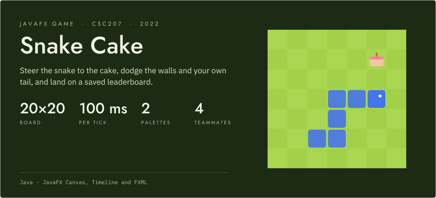
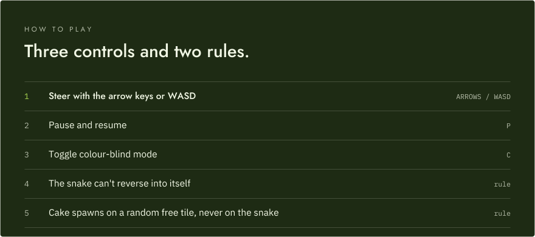
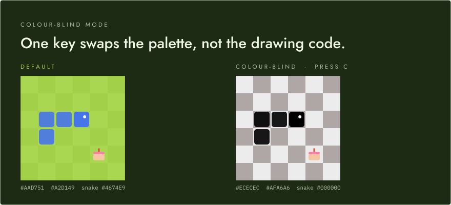
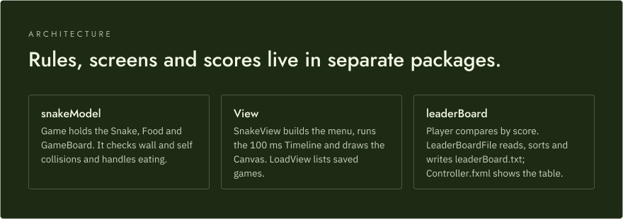

<p align="center">
  <picture>
    <source media="(prefers-color-scheme: dark)" srcset="assets/readme/hero-dark.svg">
    <source media="(prefers-color-scheme: light)" srcset="assets/readme/hero-light.svg">
    
  </picture>
</p>

<p align="center">
  <strong>A JavaFX Snake game with cake, a colour-blind mode and a saved leaderboard.</strong><br>
  <strong>20×20 board &middot; 100 ms tick &middot; 2 palettes</strong><br>
  <sub>Team project for CSC207 (Software Design), built by Haashir Khan, Andrew Kim, Aviraj Ghatora and Ryan Oakley.</sub>
</p>

<p align="center">
  
  
</p>

<!-- TODO: demo link or video -->

---

You enter a name on the main menu, play on a tiled board, and when the game ends your score is written to a local leaderboard you can open from the menu. Game logic is kept apart from the JavaFX views, so the rules can change without touching the rendering code.

## How to play

<p align="center">
  <picture>
    <source media="(prefers-color-scheme: dark)" srcset="assets/readme/controls-dark.svg">
    <source media="(prefers-color-scheme: light)" srcset="assets/readme/controls-light.svg">
    
  </picture>
</p>

The main menu has a name field and Start, Load and Leaderboard buttons. Hitting a wall or your own tail ends the game, and your score goes to the leaderboard: a JavaFX table sorted by score, kept between runs in `leaderBoard.txt`, with a colour picker for the background.

`Food` picks a random tile and retries until it finds one the snake doesn't occupy, so cake never appears under the body.

## Colour-blind mode

<p align="center">
  <picture>
    <source media="(prefers-color-scheme: dark)" srcset="assets/readme/palettes-dark.svg">
    <source media="(prefers-color-scheme: light)" srcset="assets/readme/palettes-light.svg">
    
  </picture>
</p>

The board and snake colours are model state (`GameBoard.setTileColor1/2` and `Snake.setSnakeRace`). Colour-blind mode only swaps those values, and the drawing code stays the same.

## Architecture

<p align="center">
  <picture>
    <source media="(prefers-color-scheme: dark)" srcset="assets/readme/architecture-dark.svg">
    <source media="(prefers-color-scheme: light)" srcset="assets/readme/architecture-light.svg">
    
  </picture>
</p>

`runApp` is the entry point. It creates a `Game` and hands it to `SnakeView`. Each tick of the 100 ms `Timeline` draws the frame, moves the snake, then asks `Game.gameState()` whether the head has left the board or hit the body. Rendering only reads from the model, so the collision and growth rules live in one place.

The leaderboard stores `Player` objects with Java serialization. `Player` implements `Comparable`, so the list is sorted by score before it is written back.

## Getting started

Requires a JDK and the JavaFX SDK (the FXML targets JavaFX 19). <!-- verify: tested JDK and JavaFX versions -->

The simplest route is IntelliJ IDEA:

1. Open `snakeGame/` as a project.
2. Add the JavaFX SDK `lib` folder as a library.
3. Add `--module-path /path/to/javafx-sdk/lib --add-modules javafx.controls,javafx.fxml` to the run configuration's VM options.
4. Run `runApp`.

From the command line: <!-- verify -->

```sh
cd snakeGame/src
javac --module-path "$PATH_TO_FX" --add-modules javafx.controls,javafx.fxml -d ../out $(find . -name '*.java')
# images and FXML are loaded from the classpath
cp -r img ../out/ && mkdir -p ../out/leaderBoard && cp leaderBoard/Controller.fxml ../out/leaderBoard/
java --module-path "$PATH_TO_FX" --add-modules javafx.controls,javafx.fxml -cp ../out runApp
```

The leaderboard is written to `leaderBoard.txt` in the directory you run from.

## Known limitations

- The Load screen lists `.ser` files, but nothing calls `Game.saveGame` and `Game` doesn't implement `Serializable`, so saving a game doesn't work yet.
- `Main.java` is an earlier single-file version of the game. `runApp` is the current entry point.
